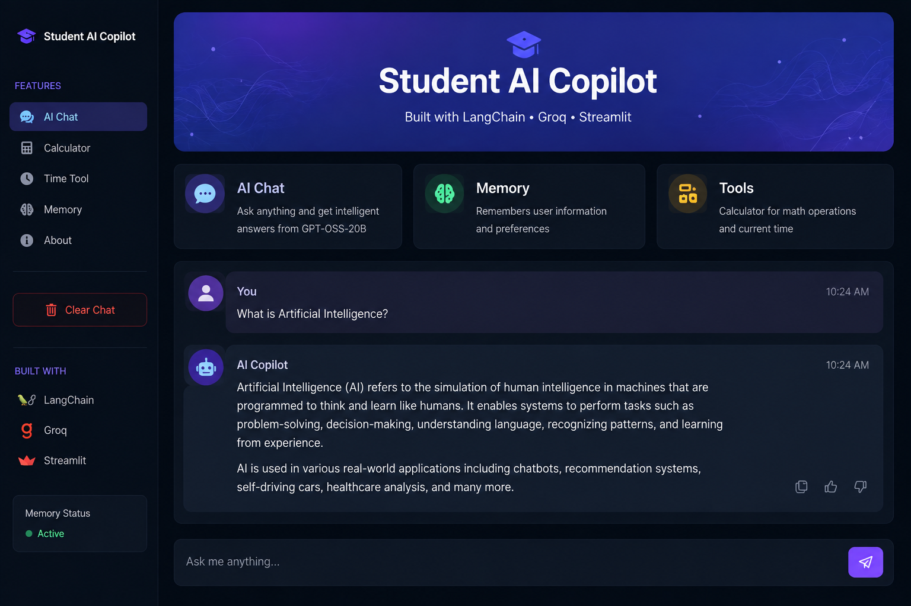

# 🎓 Student AI Copilot

A simple AI-powered student assistant built using LangChain, Groq, and Streamlit.

This project demonstrates how Large Language Models (LLMs) can be integrated with custom tools and memory to create an interactive AI assistant capable of answering questions, performing calculations, tracking user information, and providing real-time assistance through a modern web interface.

---

## 🚀 Features

- AI Chat Assistant using Groq LLM
- Prompt Templates with LangChain
- Calculator Tool
- Current Time Tool
- User Memory (stores and recalls user name)
- Interactive Streamlit UI
- Session-based Chat History
- Environment Variable Management
- Clean and Responsive Interface

---

## 🛠️ Tech Stack

- Python
- Streamlit
- LangChain
- Groq API
- Prompt Templates
- JSON Memory Storage
- dotenv

---

## 📂 Project Structure

```text
student-ai-copilot/
│
├── streamlit_app.py
├── memory.json
├── requirements.txt
├── README.md
├── .env.example
├── .gitignore
│
├── screenshots/
│   ├── home-page.png
│   ├── ai-chat.png
│   ├── memory-feature.png
│   └── calculator-feature.png
│
└── .streamlit/
    └── config.toml
```

---

## ⚙️ Installation

### Clone Repository

```bash
git clone https://github.com/yourusername/student-ai-copilot.git
cd student-ai-copilot
```

### Create Virtual Environment

```bash
python -m venv .venv
```

### Activate Virtual Environment

Windows:

```bash
.venv\Scripts\activate
```

Linux/Mac:

```bash
source .venv/bin/activate
```

### Install Dependencies

```bash
pip install -r requirements.txt
```

---

## 🔑 Environment Variables

Create a `.env` file in the project root.

```env
GROQ_API_KEY=your_groq_api_key_here
```

---

## ▶️ Run Application

```bash
streamlit run streamlit_app.py
```

Application will be available at:

```text
http://localhost:8501
```

---

## 🧠 How It Works

### AI Chat

The user enters a question through the Streamlit interface.

### Prompt Template

LangChain formats the question using a predefined prompt template.

### Groq LLM

The formatted prompt is sent to the Groq-hosted language model.

### Tools

The assistant can use:

- Calculator Tool
- Current Time Tool
- Memory Tool

### Memory

User information is stored in a local JSON file and can be recalled later.

---

## 📸 Screenshots

### Home Page


### AI Chat



### Memory Feature


### Calculator Feature


---

## 🎯 Learning Outcomes

This project helped me understand:

- LangChain Fundamentals
- Prompt Engineering
- LLM Integration
- Tool Calling Logic
- Session State Management
- Streamlit Application Development
- Environment Variable Handling
- AI Assistant Development Workflow

---

## 🔮 Future Improvements

Planned enhancements:

- PDF Upload & Question Answering
- RAG (Retrieval-Augmented Generation)
- ChromaDB Integration
- Voice Assistant
- Multiple Chat Sessions
- Chat Export Feature
- User Authentication
- Dark/Light Theme Toggle

---

## 🤝 Contributing

Contributions, suggestions, and improvements are welcome.

Feel free to fork the repository and submit a pull request.

---

## 📜 License

This project is licensed under the MIT License.

---

## 👨‍💻 Author

Santosh

Engineering Student | Generative AI Enthusiast | LangChain Learner
